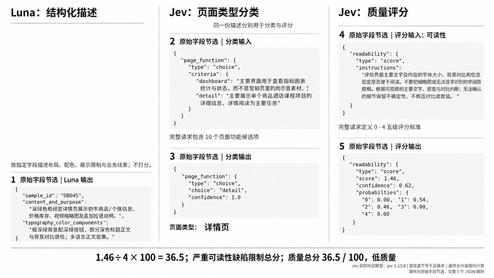
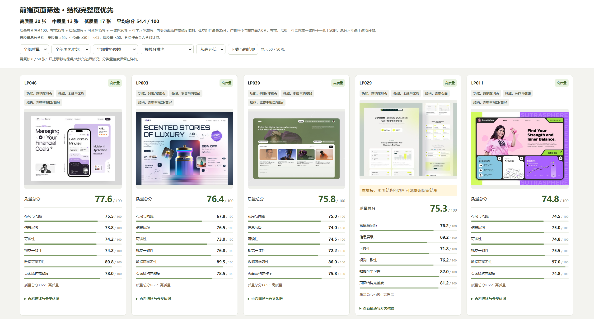

# LunaJev — Visual UI Curation

**基于 Luna + Jev 的前端界面数据质量评估与分类。**

由 Luna 将界面截图转化为结构化视觉证据，再由 Jev 根据显式定义的分类问题和评分标准，生成可追溯的页面标签与分项评分，最终通过透明规则形成质量总分与筛选依据。

*Frontend screenshot curation with Luna + Jev: structured visual captions, rubric-based evaluation, and reproducible screening decisions.*

[方法设计](#方法设计) · [实验结果](#实验结果) · [案例分析](#案例分析db045) · [离线复现](#离线复现) · [运行与数据说明](docs/reproducibility.md)

## 研究问题

前端生成模型需要能够反映页面组织和设计质量的视觉数据。然而，网页设计素材的来源标签通常描述搜索主题，难以直接作为训练数据的质量标签：

- **内容粒度不一致。** 完整页面、单个卡片、图表组件和作者宣传图可能出现在同一批素材中。
- **功能与行业相互混杂。** 金融产品的营销页可以包含仪表盘示意图；页面服务的业务领域与页面承担的用户任务需要分别判断。
- **完整度与设计质量并不等价。** 页面可以具有完整结构，同时存在低对比文字、混乱层级等明显缺陷。

本项目研究如何把这些判断转化为有明确输入、评价标准和决策记录的筛选流程。当前完成了 **Landing-page 与 Dashboard 两组、共 100 张固定随机样本的原型实验**。

## 方法设计

流程将视觉观察、模型判断和最终筛选规则分别记录，便于定位一次筛选结果的来源。



*图 1｜以真实样本 DB045 展示 Luna 输出、Jev 分类输入与输出、Jev 评分输入与输出。图中为原始字段节选，完整字段记录见 [docs/db045](docs/db045/)。*

### 1. 结构化视觉证据

Luna 逐图查看素材，按照固定字段描述画面内容。描述阶段记录可见事实和不确定项，质量等级由后续流程产生。

| 字段 | 记录内容 |
|---|---|
| `content_and_purpose` | 主体内容与用途线索 |
| `layout_components` | 页面区域、组件及其排列关系 |
| `hierarchy` | 内容主次与阅读顺序 |
| `typography_color_components` | 字体、配色与组件样式 |
| `presentation_limits` | 裁切、透视、遮挡及可辨认范围 |
| `uncertainties` | 无法确认的信息 |
| `function_evidence` / `domain_evidence` | 页面功能与业务领域的视觉证据 |

`sample_id` 将描述与样本清单、原始图片哈希及模型响应对应起来。描述不使用采集标题或来源类别替代画面判断。

### 2. 页面分类与质量评分

Jev 接收结构化描述及问题配置，分别完成两类任务：

| 任务 | 输入约束 | 输出 |
|---|---|---|
| **分类 `choice`** | 候选类别及每类的定义 | 类别、置信度、候选概率分布 |
| **评分 `score`** | 评价维度及有序的 0–4 级标准 | 分项分数、置信度、等级概率分布 |

分类使用两条独立轴：**页面功能**，如营销落地页、数据仪表盘、业务管理页、详情页；**业务领域**，如金融、教育、旅游、零售。页面来源仍保留为抽样信息。

评分覆盖六个维度：

| 维度 | 评价重点 | 在总分中的作用 |
|---|---|---|
| 布局与间距 | 对齐、分组、留白与视觉平衡 | 加权项，25% |
| 信息层级 | 内容主次与阅读顺序 | 加权项，20% |
| 可读性 | 主要文字的字号、对比与信息密度 | 加权项，15% |
| 视觉一致性 | 字体、配色及组件语言的协调程度 | 加权项，20% |
| 数据可学习性 | 从截图学习布局、组件及主要细节的充分程度 | 加权项，20% |
| 页面结构完整度 | 完整页面、主视口、局部区块之间的结构差异 | 限制最终总分 |

前五项与页面分类在第一阶段请求中评估；结构类别和完整度在第二阶段请求中评估。模型原始评分按 `score / 4 × 100` 转换为百分制，概率与置信度保留用于检查。

### 3. 约束下的质量决策

仅使用加权平均，可能使严重缺陷被其他高分项抵消。本项目保留五项加权结果作为中间量，再施加结构与缺陷限制，向使用者展示唯一的 **质量总分**：

```text
质量总分 = min(五项加权分, 页面结构完整度, 结构上限, 严重设计缺陷上限)
```

- **结构上限：**孤立组件最高 25 分；作者宣传或非界面素材为 0 分；其他结构上限为 100 分。
- **严重设计缺陷上限：**布局、层级、可读性、一致性中任一项低于 50 时，总分不能高于该项分数；未触发时不额外限制。
- **质量分档：**高质量 ≥65；中质量 ≥50 且 <65；低质量 <50。分档使用未舍入分数。

人工复核提示集中于分数靠近 50/65 分界线，以及可能影响保留决定的结构歧义。功能或行业的低置信度继续保留在详情中，不单独触发复核提示。

完整参数与实现见 [评分规则](experiments/dashboard-random-50/rule_v5.json)、[总分计算](experiments/dashboard-random-50/run_structure_v5.py) 和 [复核策略](experiments/dashboard-random-50/review_policy_v5.py)。这些阈值是当前实验的启发式定义，后续需要人工标注校准。

## 实验结果

从 Landing-page 和 Dashboard 两类各 10,000 张候选素材中分别随机抽取 50 张，每组均对应 50 个不同作品。仓库保留随机种子、抽样方法、来源作品链接和图片 SHA-256，以便追溯样本。

两组实验使用相同的最终评分规则：

| 样本来源 | 样本量 | 高质量 | 中质量 | 低质量 | 平均总分 |
|---|---:|---:|---:|---:|---:|
| Landing-page | 50 | 20 | 13 | 17 | 54.4 |
| Dashboard | 50 | 27 | 10 | 13 | 56.0 |

**表中数字表示当前规则下的筛选分布。** 当前尚未建立人工金标准，因此不将该分布解释为分类准确率、质量识别准确率或下游性能提升。

来源与实际内容的差异也体现在分类结果中：Dashboard 来源的 50 张素材里，Jev 判断 29 张为数据仪表盘、11 张为业务管理页、5 张为非界面素材，其余 5 张属于其他功能。

### 结果检查界面



*图 2｜Landing-page 样本的本地检查界面。支持按质量、页面功能及业务领域筛选，按总分或分项排序，展开视觉依据与置信度，并下载当前筛选结果。截图中的原图预览来自本地素材，公开仓库的报告在缺少原图时显示来源作品链接。*

| 实验记录 | 描述 | 问题配置 | 模型响应 | 导出结果 |
|---|---|---|---|---|
| Landing-page | [Caption](experiments/landing-page-random-50/captions_structured_v5.json) | [分类与设计](experiments/landing-page-random-50/questions_v4.json) / [结构](experiments/landing-page-random-50/questions_v5.json) | [第一阶段](experiments/landing-page-random-50/jev_results_v4.json) / [最终记录](experiments/landing-page-random-50/jev_results_v5.json) | [CSV](experiments/landing-page-random-50/classification_scores_v5.csv) |
| Dashboard | [Caption](experiments/dashboard-random-50/captions_structured_v5.json) | [分类与设计](experiments/dashboard-random-50/questions_v4.json) / [结构](experiments/dashboard-random-50/questions_v5.json) | [第一阶段](experiments/dashboard-random-50/jev_results_v4.json) / [最终记录](experiments/dashboard-random-50/jev_results_v5.json) | [CSV](experiments/dashboard-random-50/classification_scores_v5.csv) |

## 案例分析：DB045

DB045 是一张结构完整的畜牧商品详情页。Luna 的实际描述记录了一个重要问题：

> 极深绿背景配亮绿按钮，部分深色标题正文与背景对比很低；多语言正文密集。

Jev 根据预设的可读性等级标准，返回如下字段：

```json
{
  "type": "score",
  "score": 1.46,
  "confidence": 0.62,
  "probabilities": {
    "0": 0.00,
    "1": 0.54,
    "2": 0.46,
    "3": 0.00,
    "4": 0.00
  }
}
```

该分数对应 `1 × 0.54 + 2 × 0.46 = 1.46`，转换后可读性为 **36.5/100**。完整输入问题与响应字段见 [真实案例记录](docs/db045/)。

| 判断依据 | 实际结果 |
|---|---:|
| 页面结构完整度 | 89.25 |
| 数据可学习性 | 80.00 |
| 可读性 | 36.50 |
| 视觉一致性 | 44.50 |
| 仅五项加权时的中间结果 | 55.6375 |
| 施加严重缺陷限制后的质量总分 | **36.50，低质量** |

这个失败样本暴露了平均分对严重缺陷的补偿效应，并促成了当前的缺陷限制规则。同样的规则随后应用到两批全部 100 张样本。

页面功能的实际输出为 `detail`（详情页），业务领域输出为 `other`（其他领域）。描述中的畜牧交易线索进一步反映出当前行业候选集合的覆盖边界。

## 离线复现

需要 **Python 3.10+**，核心脚本仅依赖标准库。使用仓库中的已保存响应，即可重新计算全部分数、标签与复核提示，无需 API 密钥。

```bash
git clone https://github.com/starry913/ui-quality-curator.git
cd ui-quality-curator
python tools/replay.py
python -m unittest discover -s tests -v
```

运行后打开根目录的 `index.html`，或直接打开两组实验目录下的 `review.html`。离线重放不会调用模型，也不会读取 API 密钥。

验证覆盖 100 张样本的分数换算与总分计算、50/65 分档边界、严重缺陷限制，以及缺少原图时报告与导出的完整性。GitHub Actions 在提交时执行相同检查，并验证报告脚本语法。

## 可复现记录与运行边界

仓库包含代码、结构化描述、问题配置、解析后的实际 API 响应、导出结果和采样元数据。Luna 描述在交互式 Codex 会话中生成，实际查看范围及额外原图复核记录见各组的 `caption_provenance_v4.json`；当前仓库不提供独立的 Luna 推理服务。

Jev 历史响应模型为 `jev-1.13.0`，运行器请求使用 `jev-latest`。**离线重放用于验证保存记录与决策规则；重新调用模型时，输出可能随模型版本或推理过程变化。**

新数据接入、API 配置、检查点行为与脚本版本对应关系，见 [运行与复现说明](docs/reproducibility.md)。

## 局限与后续工作

- **质量标准需要校准。** 当前权重、阈值与分数上限来自原型迭代，下一步需建立人工标注集，评估分类与评分的一致性。
- **文本描述可能损失图像细节。** Caption 中的遗漏或错误会传递到后续判断，需要结合原图检查和更系统的描述一致性验证。
- **候选类别影响分类覆盖。** 当前行业集合不包含所有领域，需要在保留未知和其他类别的同时，评估如何扩展分类体系。
- **下游收益仍待验证。** 计划比较不同筛选规则、描述方式与数据组成，并评估筛选前后数据对前端生成质量的影响。

## 数据说明

完整原始图库与 API 密钥不在仓库中。README 保留方法示意图及少量界面展示截图；`samples.csv` 保留公开作品链接与原图哈希，供来源追溯。原设计作品权利归其作者，本仓库不授予第三方素材的使用许可。
